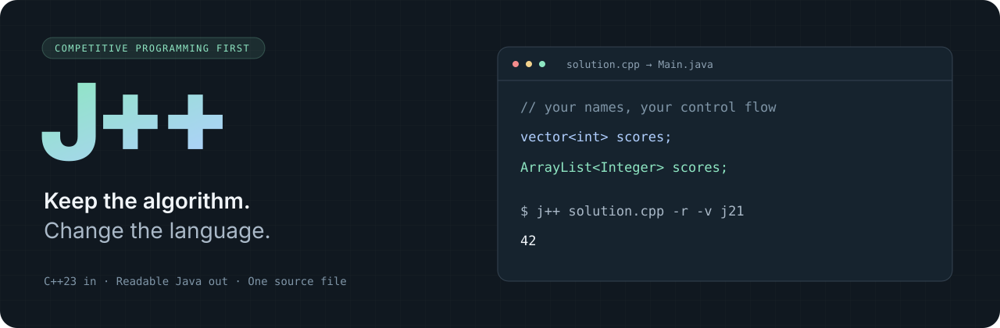

<p align="center">
  
</p>

<p align="center">
  <a href="https://github.com/Irvinwop/JPlusPlus/actions/workflows/ci.yml"></a>
  
  
  <a href="LICENSE"></a>
</p>

J++ translates C++ solutions into **readable, self-contained Java**. Keep your variable names, functions, structs, and algorithms. Get a single `.java` file you can inspect, compile, and submit.

**Early development.** GNU++23 is the input dialect, not a claim of full language or standard-library coverage. Competitive programming comes first. Unsupported constructs are rejected; [compatibility](docs/compatibility.md) documents the current boundary.

```sh
j++ solution.cpp -t                 # solution.cpp → Main.java
j++ solution.cpp -r                 # transpile, compile, run
j++ solution.cpp -r -v j8           # target Java 8
j++ solution.cpp --check -o Solve.java
```

## What the output looks like

Your algorithm stays in ordinary Java methods. `vector<T>` becomes `ArrayList<T>`, fixed and variable length C arrays become Java arrays, and user structs become nested classes. Support helpers handle C++ behavior such as value copies, mutable references, pairs, and iterators. Only the helpers your program uses are included.

| C++ | Generated Java |
| :-- | :-- |
| `vector<int> scores;` | `ArrayList<Integer> scores = new ArrayList<Integer>();` |
| `scores.push_back(value);` | `scores.add(value);` |
| `scores[i]` | `scores.get(i)` |
| `get<0>(edge)` | `edge.item0` for a value tuple |
| `long long answer` | `long answer` |
| `int values[n];` | `int[] values = new int[n];` |
| `__builtin_popcountll(mask)` | `Long.bitCount(mask)` |

The result uses the Java standard library. It needs no J++ installation, jars, JNI, native executable, or interpreter at runtime. Some C++ operations need extra helpers rather than a literal spelling change; [the architecture guide](docs/architecture.md) explains why.

## Build

Linux is the supported development platform. Install LLVM/Clang 18 development libraries, a C++23 compiler, CMake, and Ninja. A JDK is needed for `-r` and `--check`, but not for transpilation alone.

```sh
# Ubuntu 24.04
sudo apt-get install clang-18 llvm-18-dev libclang-18-dev \
  libclang-cpp18-dev cmake ninja-build openjdk-21-jdk-headless

git clone https://github.com/Irvinwop/JPlusPlus.git
cd JPlusPlus
cmake -S . -B build -G Ninja -DCMAKE_BUILD_TYPE=Release \
  -DCMAKE_CXX_COMPILER=clang++-18 \
  -DLLVM_DIR=/usr/lib/llvm-18/lib/cmake/llvm
cmake --build build
cmake --install build --prefix "$HOME/.local"
```

Ensure `~/.local/bin` is on your `PATH`. The executable is named `j++`.

For GNU `void*` offsets and the large-array frontend fix, use the optional [GNU compatibility frontend](toolchain/README.md).

Try the included example:

```sh
printf '5\n1 2 3 4 5\n' | j++ examples/sum.cpp -r
# 15
```

## CLI

```text
j++ <source.cpp> [options] [-- program-arguments...]
```

| Option | Effect |
| :-- | :-- |
| `-t`, `--transpile` | Generate Java; this is the default. |
| `-r`, `--run` | Generate, compile, and run. Forward standard input, output, and exit status. |
| `-v j21\|j17\|j8` | Set the Java target. Default: `j21`. |
| `-o File.java` | Choose the output path and class name. Default: `Main.java` beside the input. |
| `--class Name` | Set the class name explicitly; the output filename must match. |
| `--check` | Validate with a Java compiler before replacing the output. |
| `-I directory`, `-D definition` | Forward C++ include paths and preprocessor definitions. |
| `--cpp-arg argument` | Forward another Clang argument; repeat as needed. |
| `--no-source-comments` | Omit C++ line references from generated Java. |
| `--help`, `--version` | Show usage or version information. |

`ONLINE_JUDGE` is defined by default. Override it with `-U ONLINE_JUDGE` if your source needs local code paths.

`JPP_JAVA` and `JPP_JAVAC` select Java executables. For example:

```sh
JPP_JAVA=/opt/openj9/bin/java j++ solution.cpp -r -v j17
```

The default Java compiler must support `--release` for the chosen target. A current JDK can generate Java 8 output. Temporary class files are cleaned up automatically. Errors leave an existing output file intact.

## Testing

The integration suite compiles each fixture as native GNU++23, transpiles it, compiles the Java, and compares actual output on deterministic randomized inputs. It covers arrays, sorting and bounds, nested-container copies, Dijkstra, maps and sets, strings and struct copies, recursive lambdas, references, assignment sequencing, boolean promotions, C++23 constructs, `__int128`, unsigned arithmetic, and GNU intrinsics. It also checks CLI exit codes and output preservation on failure.

```sh
ctest --test-dir build --output-on-failure
```

Use multiple independent compilers and JVMs for the same test run:

```sh
JPP_TEST_JAVACS=/opt/jdk21/bin/javac:/opt/jdk17/bin/javac:/usr/bin/ecj \
JPP_TEST_JAVAS=/opt/jdk21/bin/java:/opt/openj9-17/bin/java \
  build/jpp-tests
```

See [testing](docs/testing.md) for the compiler/runtime matrix and the distinction between compile coverage and behavioral coverage.

## Direction

- Expand real competitive-programming compatibility using native/Java differential tests.
- Keep generated code readable, use standard Java collections, and preserve source names.
- Extend C++23 and GNU intrinsic support with explicit semantics and diagnostics.
- Broaden language coverage toward the original GNU++23 goal; full conformance is unfinished.

[Compatibility](docs/compatibility.md) · [Architecture](docs/architecture.md) · [Contributing](CONTRIBUTING.md) · [Apache 2.0 license](LICENSE)
